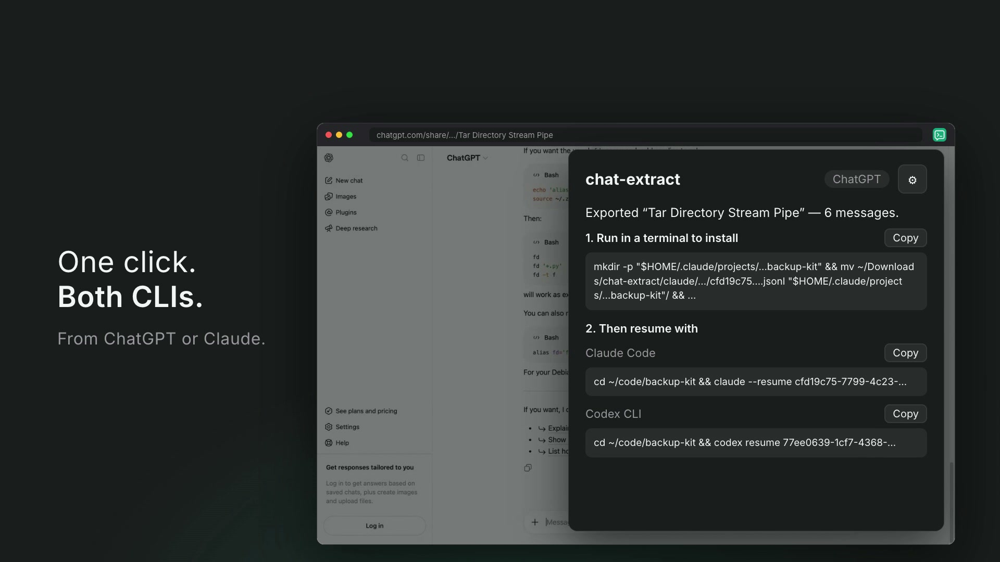

# chat-extract

**Keep the conversation. Change the tool.**

chat-extract is a Chrome extension that exports the ChatGPT or Claude conversation you have open into a session that **Claude Code** or **Codex CLI** can resume. You work something out in the browser, click once, and carry on in the terminal with the agent already holding the whole conversation.



## Install

- **Chrome Web Store:** _coming soon_
- **From source:** clone this repo, open `chrome://extensions`, turn on **Developer mode**, click **Load unpacked**, and select the repo folder. It also works in Brave, Edge and other Chromium browsers (version 105+).

## Use

1. Open a conversation on **chatgpt.com** (`/c/…` or `/share/…`) or **claude.ai** (`/chat/…`).
2. Click the chat-extract icon, tick **Claude Code** and/or **Codex CLI**, and enter the **project path**: the absolute folder you want to resume in, e.g. `/Users/you/code/app`.
3. Click **Export**. The session files download, and the popup shows:
   - **one install command** that moves them into `~/.claude` / `~/.codex`, which you paste into a terminal
   - **a resume command per CLI**, e.g. `cd '/Users/you/code/app' && claude --resume <id>`

   The popup closes when you click away, so it reopens on these commands until you export again or change the project path.

The ⚙ page sets the model each CLI resumes with (defaults: `claude-opus-5-5` and `gpt-6-astra`).

**What's exported:** every visible message on the branch you're viewing, including ChatGPT voice-mode transcripts. Abandoned edit branches, hidden system messages, tool calls and model "thinking" are left out.

## Privacy

The extension runs only when you click it, and only on the tab you're on. It converts the conversation inside your browser and saves files to your Downloads folder. It has no servers, analytics, or tracking. Details: [PRIVACY.md](PRIVACY.md).

## Compatibility

chat-extract relies on **undocumented** internals: ChatGPT's and claude.ai's conversation APIs, and Claude Code's and Codex's session file formats. It was tested with **Claude Code 2.1.280** and **Codex CLI 0.154.0** (September 2026). When one of those tools changes its format, an export can stop resuming. Please [open an issue](https://github.com/tickloop/chat-extract/issues) with the CLI version, or send a fix. The "Format notes" below say where to look.

## How it works

```
frontend (per site) ──► IR (JSONL) ──► backend (per CLI) ──► downloaded file + install/resume commands
```

| Layer | Files | Contract |
|---|---|---|
| Frontends | `src/frontends/{chatgpt,claude}.js` | `{ id, label, matches(url), scrape(), toIR(raw, url) }`. `scrape` is injected into the page (MAIN world) and must be self-contained; `toIR` is pure. |
| IR | `src/ir.js` | Conversation header + messages with typed `parts`. Backends ignore part types they don't know. |
| Backends | `src/backends/{claude-code,codex}.js` | `{ id, label, needsProjectPath, options, render(ir, opts), install(file) }` |
| Pipeline | `src/pipeline.js` | Renders the selected backends and builds the single install command. It has no `chrome.*` calls, so it runs in node tests. |
| Popup | `popup/` | Export → Result pages plus Settings (fields generated from backend `options`). |

To add a site or a CLI, write one module and add it to `src/frontends/index.js` or `src/backends/index.js`.

### Format notes

- **ChatGPT:** the conversation is a tree (`mapping` + `current_node`). Share pages embed it in `window.__reactRouterDataRouter`; `/c/` pages fetch it from `/backend-api/conversation/<id>`.
- **claude.ai:** `/api/organizations/<org>/chat_conversations/<id>?tree=True`. The org comes from the `lastActiveOrg` cookie, and the active branch runs from `current_leaf_message_uuid`.
- **Claude Code:** `~/.claude/projects/<cwd with non-alphanumerics → '->/<session>.jsonl`. Every assistant turn needs a real Claude model id, and each export uses fresh UUIDs so a still-open resume can't corrupt a re-export.
- **Codex CLI:** `~/.codex/sessions/YYYY/MM/DD/rollout-<local time>-<id>.jsonl` with `history_mode: "paginated"`. The TUI shows history from `item_completed` events (which need a `thread_id`) and restores the model from `turn_context`.
- The project path must be absolute: both CLIs key sessions by the literal cwd.

## Develop

```bash
fnm use            # Node from .node-version
npm test           # node:test, synthetic fixtures only
```

Reload the unpacked extension at `chrome://extensions` after changes.

## Release

```bash
npm run bump       # patch bump in manifest.json + package.json; or: npm run bump minor | major | 1.2.3
npm run package    # tests + dist/chat-extract-<version>.zip (allowlisted files only)
```

`icons/source/make_icons.py` regenerates the toolbar icons from the 1024px source.

## License

[MIT](LICENSE). chat-extract is an independent project, not affiliated with or endorsed by OpenAI or Anthropic. ChatGPT, Codex, Claude and Claude Code are trademarks of their respective owners.
